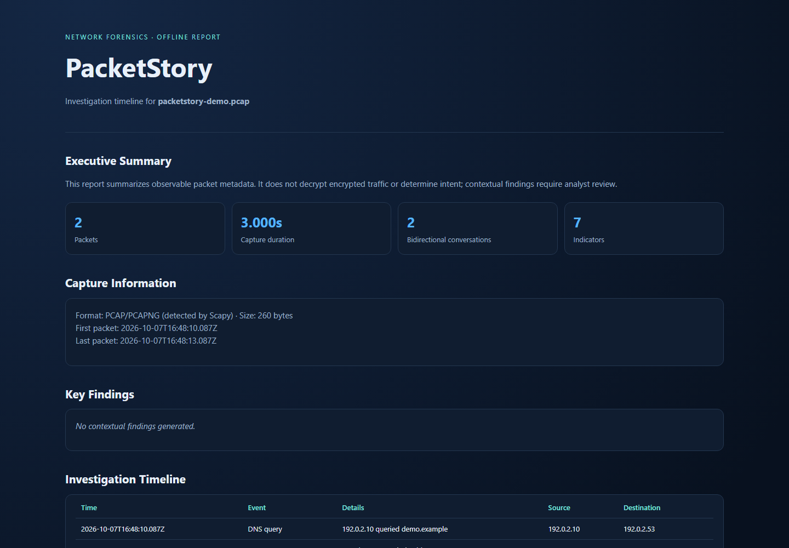

# PacketStory

**Network Forensics & PCAP Investigation Assistant** · v0.1.0

PacketStory turns local PCAP and PCAPNG captures into a chronological investigation timeline, traffic summary, indicators, and a self-contained HTML report. It is designed for incident response, education, and lab analysis.

## Why PacketStory

Large captures hide useful context in repetitive packet details. PacketStory groups visible metadata into a reviewable timeline while keeping packet contents on the analyst's machine.

## Features

- Reads PCAP and PCAPNG through Scapy.
- Extracts Ethernet/ARP, IPv4/IPv6, TCP/UDP/ICMP, DNS, visible HTTP/1 metadata, and SNI from complete visible TLS ClientHello records.
- Summarizes packet counts, duration, protocol distribution, top talkers/destinations/ports, bidirectional TCP/UDP endpoint pairs, DNS/HTTP counts, and SYN attempts.
- Labels indicators as observed or interesting and explains review cues.
- Creates offline HTML and JSON reports; report values are HTML-escaped.
- Packet processing has a configurable internal ceiling of two million packets.

## Architecture

`parser.py` ingests and normalizes packet metadata; `models.py` defines analysis records; `report.py` emits JSON and standalone HTML; `cli.py` provides the command interface. Payload inspection is limited to visible HTTP headers and TLS handshake metadata.

## Installation

```powershell
cd cybersecurity-projects/packetstory
py -3.12 -m venv .venv
.\.venv\Scripts\Activate.ps1
python -m pip install --upgrade pip
python -m pip install -e ".[dev]"
```

Alternatively install runtime dependencies with `python -m pip install -r requirements.txt`.

## Quick Start

```console
packetstory --help
packetstory analyze capture.pcap --output report.html --json report.json
packetstory timeline capture.pcap
packetstory iocs capture.pcap
packetstory stats capture.pcap
packetstory info capture.pcap
```

Run locally without installation: `python -m packetstory.cli --help` (from an editable install environment).

## Example Output

```text
PacketStory analyzed lab.pcapng: 124 packets, 18 timeline events, 7 indicators.
HTML report written to report.html
```

The HTML report contains an executive summary, capture metadata, key findings, chronological events, conversations, DNS, HTTP, TLS, indicators, statistics, analyst notes, and limitations.

## Demo Data

`examples/generate_demo.py` creates a small synthetic capture with RFC 5737 documentation IPs and fake DNS/HTTP metadata. Run it in an installed environment, then analyze the generated file. The checked-in [sample report](examples/sample-report.html) and [sample JSON](examples/sample-analysis.json) use only synthetic data.

```console
python examples/generate_demo.py
packetstory analyze examples/packetstory-demo.pcap --output examples/sample-report.html --json examples/sample-analysis.json
```

## Security and Privacy

Use captures you are authorized to inspect. PCAP contents can contain sensitive personal or authentication data even when this tool does not print packet bodies. The tool does not decrypt TLS, execute packet content, or upload captures. Findings are review cues, not proof of maliciousness.

## Report Preview

The report below was generated from the checked-in synthetic demo capture. Its addresses are reserved documentation IPs; no real traffic or external service is shown.



## Roadmap

- Reassemble TCP streams for fragmented HTTP metadata.
- Add TLS certificate metadata extraction across capture variants.
- Add richer protocol dissectors and analyst-controlled redaction.
- Add sampling options for very large captures.

## Contributing

See [CONTRIBUTING.md](CONTRIBUTING.md), [SECURITY.md](SECURITY.md), and [CHANGELOG.md](CHANGELOG.md).

## License

MIT. See [LICENSE](LICENSE).
